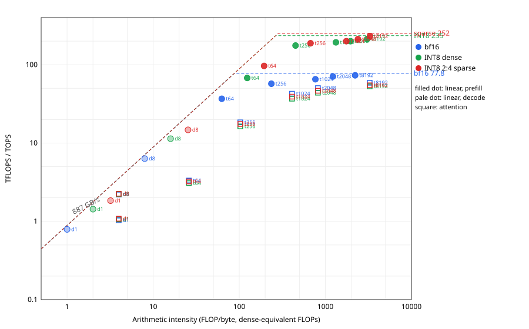

# Qwen3-8B 在 RTX 3090 上的瓶颈、开销与 roofline

日期：2026-11-07。环境同 `../report.md`（vLLM 基线 `7dca18e206` 加本分支补丁，torch 2.14.0+cu130，驱动 580.119.02）。nsys 不可用，全部用 torch profiler 和 PyTorch 计时。

路线：bf16、稠密 INT8（`int8_dense`）、稀疏 INT8（`int8_24_obr` + `--linear-backend cutlass_sparse`）。kernel 级数据复用 `../forward/` 的 `vllm bench forward` trace（稀疏用 `sparse_col`，即融合转置的版本）。serving 级数据为本次新采：A（256×1，生成 33）、D（1024×8，生成 33）、F（256×8，生成 129），流式，每组合 3 次。

## 结论

| 问题 | 回答 | 依据 |
| ---- | ---- | ---- |
| Prefill 受什么限制 | **D、F 和 bf16 的 A 受算力限制；INT8、稀疏的 A 受 CPU 发射限制。** | D、F 在 Prefill 区间内 GPU 忙碌 95%～99.7%，线性层占 GPU 时间 76%～95%。线性层算术强度 230～3800 FLOP/B，高于拐点（bf16 88、INT8 265），达到算力上限的 71%～95%（bf16）和 53%～102%（INT8）。INT8、稀疏的 A：Prefill 的 CPU `execute_model` 是 29～32 ms，GPU 只忙 21.4～21.7 ms，区间内空闲 6.5～9.2 ms（有 profiler 放大，见坑 68） |
| Decode 受什么限制 | **显存带宽。** CPU 不是瓶颈 | 线性层算术强度 1～25 FLOP/B，远低于拐点，跑到读带宽的 81%～94%（bf16）、70%～87%（INT8）、47%～77%（稀疏）。每步 GPU 忙碌 99%～99.9%，空闲 0.03～0.18 ms。CPU 每步 5.0～7.1 ms 的工作被异步调度藏在 GPU 后面。全部 Decode 步都走 CUDA Graph |
| Decode 离带宽下限多远 | bf16 **1.19～1.21 倍**，INT8 **1.36～1.39 倍**，稀疏 **1.71～1.77 倍** | 见第 5 节。差距的大头是线性层没跑满带宽（1.9～2.75 ms），其次是 Decode 注意力（A 0.5 ms，D 1.0～1.1 ms）、小 kernel（0.55～0.73 ms）、激活量化（0.3 ms）、稀疏的补齐拷贝（0.3～0.7 ms）。`lm_head` 本身已在带宽上限 |
| 线性层以外占多少 | Decode（占 GPU 忙碌）：A 中 13%～29%，D 中 21%～42%（含 `lm_head`、采样和稀疏的补齐）。Prefill（D）：7%～24% | 第 3 节表格 |
| 下一步最值得优化什么 | **推测**：对 INT8、稀疏路线，先做 `lm_head` 量化，再提高 Decode 线性 kernel 的带宽利用率 | `lm_head` 仍是 bf16，每步固定读 1.245 GB、1.40～1.43 ms，占 INT8 TPOT 的 10%～11%、稀疏的 11%～13%。按 INT8 存放可省约 0.7 ms，这是按字节数估算，未测。线性层到带宽上限的差距是 1.9～2.0 ms（INT8）、2.7 ms（稀疏），但要改 kernel |
| 稀疏 kernel 省的是什么 | **Decode 省带宽，Prefill 省算力，但两边都没吃满。** | Decode：权重字节少 37.5%，线性时间只少 21.5%（9.71→7.62 ms），因为带宽利用率从 81% 降到 65%，另有 0.3～0.7 ms 补齐拷贝。Prefill：微基准的等效吞吐只比稠密 CUTLASS 高 1.11～1.19 倍（比 `torch._int_mm` 高 1.01～1.09 倍），远不到 2 倍；同时功耗墙、列主序写出（坑 56）和不受影响的注意力等部分（INT8 t8192 中占 47%）吃掉了收益 |
| CPU 侧开销 | **TTFT 中**：A 6%（bf16）、23%～25%（INT8、稀疏，另加 Prefill 内空闲）；D 1%～3%；F 3%～7%。**TPOT 中**：≤1%（GPU 空闲）。 | 第 4 节。CPU 侧 = 排队到调度、调度到 GPU 开始、输出回到引擎、前端（IPC + detokenize + HTTP）。前端 trace 是空的，HTTP 和 detokenize 拆不开（坑 64） |
| bf16 并发能力（第 7 节压测） | 吞吐拐点在并发 32（607 tok/s），之后 KV 占满，抢占使吞吐降 9%～11%；持续到达时服务能力约 2.2 req/s（1024/128），SLO-A 下最多约 2 req/s；前端不是瓶颈 | 闭环并发扫描、长上下文、Poisson 到达，每组合 3 次。Prefill 每次插入会让 Decode 卡住约 235～260 ms（ITL P95） |

## 1. 硬件上限

`scripts/roof.py`，空闲 GPU，3 次，每次连续 10～20 次取平均。原始值在 `roof.json`，时钟采样在 `clocks_roof.csv`。

| 项目 | 白皮书（GA102 v2，附录 A 表 9） | 实测中位数（最大） | 占白皮书 |
| ---- | ---- | ---- | ---- |
| BF16 Tensor，FP32 累加 | 71 TFLOPS（稀疏 142），按 1695 MHz | 8192³ `torch.mm`：**77.8**（78.3）TFLOPS；gate_up 形状 76.2，down 形状 74.4 | 110% |
| INT8 Tensor | 284 TOPS（稀疏 568） | 8192³ `torch._int_mm`：**235.2**（238.4）；`cutlass_scaled_mm` 211.5（221.1）；gate_up 形状 189.5，down 形状 215.3 | 74%～83% |
| INT8 2:4 稀疏（等效稠密） | 568 TOPS | 本分支 `sparse_int8_mm`：8192³ **252.5**（266.8），gate_up 210.3，down 252.7 | 44% |
| 显存带宽 | 936 GB/s（19.5 Gbps × 384 bit） | 读（`sum`）**887**，写（`fill_`）890，拷贝（读 + 写）845，bf16 GEMV 826 GB/s | 95%（读） |
| 其他 | 82 SM，L2 6 MB，TGP 350 W | | |

- **bf16 比白皮书高，是因为时钟。** 负载下 SM 时钟最高 1935 MHz，白皮书按 boost 1695 MHz 计算。按 1935 MHz 折算，峰值约 81 TFLOPS，实测是它的 96%。
- **INT8 达不到白皮书，原因是功耗墙。** INT8 测试期间功耗达 349 W，throttle reason 为 0x4（软件功耗上限），SM 时钟在 1425～1935 MHz 之间波动，负载样本均值 1729 MHz。逐 kernel 的时钟没有测，这一归因是推测。
- **显存时钟实际是 9501 MHz（19.0 Gbps），** 理论 912 GB/s，读带宽实测是它的 97%。
- **后文使用的 roof：** bf16 77.8 TFLOPS，INT8 235.2 TOPS，稀疏等效 252.5 TOPS，带宽 887 GB/s。拐点是 bf16 88、INT8 265、稀疏 285 FLOP/B。INT8 t8192 的 `down` 算出 102%，稀疏是 110%，说明 roof 本身会随功耗状态浮动，差 10% 以内不要过度解读。

## 2. kernel 级 roofline

数据来自 `../forward/prof/<路线>/<case>.rank0.trace.json.gz`，是 3 次回放的中位数。kernel 按层内顺序归类（坑 19、70）：注意力之后的线性层是 `o`，`fused_add_rms_norm` 之后是 `gate_up`，`act_and_mul` 之后是 `down`，其余是 `qkv`。全名核对在 `kernel_names.csv`。

- FLOPs：线性层 2·T·K·N；Prefill 注意力 4·H·d·T(T+1)/2（因果）；Decode 注意力 4·H·d·L·B。
- 字节：权重（bf16 2 B，INT8 1 B，稀疏 0.625 B/参数）+ 输入激活 + bf16 输出；注意力是 Q、K、V、O 各读写一次；其他 kernel 按读写的激活计算。
- `bench forward` 不含 `lm_head` 和采样，这两项见第 4 节。

完整结果在 `kernel_roofline.csv`（5 条路线 × 9 个 case × 各类别），图在 `roofline.svg`，点在 `roofline_points.csv`。



### 2.1 每类时间（ms，括号内为占整个前向的比例）

**Decode，1 个请求，KV 1024（d1）**

| 类别 | bf16 | INT8 | 稀疏 |
| --- | --- | --- | --- |
| 线性 qkv | 2.29 (12.1%) | 1.46 (12.9%) | 0.95 (10.1%) |
| 线性 o | 1.64 (8.7%) | 0.94 (8.4%) | 0.91 (9.7%) |
| 线性 gate_up | 8.71 (46.0%) | 4.97 (44.0%) | 3.36 (35.7%) |
| 线性 down | 4.96 (26.2%) | 2.35 (20.9%) | 2.34 (24.9%) |
| 注意力 | 0.59 (3.1%) | 0.57 (5.1%) | 0.56 (5.9%) |
| 激活量化 | — | 0.30 (2.6%) | 0.30 (3.2%) |
| norm | 0.20 (1.0%) | 0.19 (1.7%) | 0.19 (2.0%) |
| q/k norm | 0.14 (0.7%) | 0.14 (1.2%) | 0.14 (1.5%) |
| 激活函数 | 0.14 (0.7%) | 0.13 (1.2%) | 0.14 (1.5%) |
| rotary | 0.11 (0.6%) | 0.11 (0.9%) | 0.11 (1.1%) |
| KV 写入 | 0.08 (0.4%) | 0.08 (0.7%) | 0.08 (0.8%) |
| 其他（拷贝、补齐） | 0.09 (0.5%) | 0.04 (0.4%) | 0.33 (3.6%) |
| **合计** | **18.95** | **11.28** | **9.40** |

**Decode，8 个请求，KV 各 1024（d8）**

| 类别 | bf16 | INT8 | 稀疏 |
| --- | --- | --- | --- |
| 线性（4 项合计） | 17.60 (85.3%) | 9.77 (74.9%) | 7.53 (66.2%) |
| 注意力 | 2.19 (10.6%) | 2.16 (16.6%) | 2.14 (18.8%) |
| 激活量化 | — | 0.30 (2.3%) | 0.30 (2.6%) |
| norm + q/k norm + 激活 + rotary + KV 写入 | 0.69 (3.3%) | 0.67 (5.1%) | 0.68 (6.0%) |
| 其他 | 0.17 (0.8%) | 0.16 (1.2%) | 0.74 (6.5%) |
| **合计** | **20.64** | **13.06** | **11.39** |

**Prefill，1 条序列**

| 类别 | bf16 t256 | INT8 t256 | 稀疏 t256 | bf16 t8192 | INT8 t8192 | 稀疏 t8192 |
| --- | --- | --- | --- | --- | --- | --- |
| 线性 qkv | 7.75 (11.8%) | 3.71 (15.1%) | 3.54 (15.4%) | 203.0 (10.3%) | 72.5 (7.1%) | 70.8 (7.4%) |
| 线性 o | 5.59 (8.5%) | 1.94 (7.9%) | 1.71 (7.5%) | 139.5 (7.1%) | 48.3 (4.8%) | 47.1 (4.9%) |
| 线性 gate_up | 31.90 (48.6%) | 9.62 (39.2%) | 9.79 (42.6%) | 799.7 (40.8%) | 289.3 (28.5%) | 265.7 (27.7%) |
| 线性 down | 16.90 (25.7%) | 4.95 (20.2%) | 3.84 (16.7%) | 410.6 (20.9%) | 123.5 (12.2%) | 106.4 (11.1%) |
| 注意力 | 1.05 (1.6%) | 1.19 (4.9%) | 1.11 (4.8%) | 336.2 (17.1%) | 373.4 (36.8%) | 362.1 (37.7%) |
| 激活量化 | — | 0.78 (3.2%) | 0.72 (3.1%) | — | 33.6 (3.3%) | 33.6 (3.5%) |
| norm + q/k norm | 1.01 (1.5%) | 1.07 (4.4%) | 1.02 (4.4%) | 35.8 (1.8%) | 36.9 (3.6%) | 36.5 (3.8%) |
| 激活函数 | 0.83 (1.3%) | 0.85 (3.5%) | 0.85 (3.7%) | 25.7 (1.3%) | 25.7 (2.5%) | 25.6 (2.7%) |
| rotary + KV 写入 | 0.40 (0.6%) | 0.42 (1.7%) | 0.40 (1.8%) | 11.4 (0.6%) | 11.7 (1.1%) | 11.6 (1.2%) |
| **合计** | **65.69** | **24.53** | **22.99** | **1961.9** | **1015.1** | **959.2** |

t8192 的注意力在量化路线上比 bf16 慢 8%～11%（336→362～373 ms），而它的计算完全相同。**推测**是 INT8 GEMM 把功耗推到上限后降低了时钟，没有验证。

### 2.2 线性层在 roofline 上的位置

| 路线 | case | 投影 | AI（FLOP/B） | 实际 | 占算力 roof | 占带宽 roof |
| --- | --- | --- | --- | --- | --- | --- |
| bf16 | d1 | qkv / o / gate_up / down | 1.0 | 790 / 736 / 833 / 731 GB/s | ~1% | 89% / 83% / 94% / 82% |
| bf16 | d8 | 同上 | 8.0 | 811 / 743 / 837 / 720 GB/s | ~8% | 91% / 84% / 94% / 81% |
| bf16 | t256 | 同上 | 228～239 | 60 / 55 / 58 / 55 TFLOPS | 77% / 71% / 75% / 71% | — |
| bf16 | t8192 | 同上 | 1638～2458 | 73 / 71 / 74 / 72 TFLOPS | 94% / 91% / 95% / 93% | — |
| INT8 | d1 | 同上 | 2.0 | 623 / 642 / 730 / 770 GB/s | <1% | 70% / 72% / 82% / 87% |
| INT8 | d8 | 同上 | 15.9 | 624 / 642 / 728 / 767 GB/s | ~5% | 70% / 72% / 82% / 87% |
| INT8 | t256 | 同上 | 431～464 | 125 / 159 / 193 / 188 TOPS | 53% / 68% / 82% / 80% | — |
| INT8 | t8192 | 同上 | 2341～3781 | 205 / 205 / 205 / 240 TOPS | 87% / 87% / 87% / 102% | — |
| 稀疏 | d1 | 同上 | 3.2 | 599 / 414 / 675 / 484 GB/s | <1% | 68% / 47% / 76% / 55% |
| 稀疏 | d8 | 同上 | 25.4 | 606 / 420 / 681 / 488 GB/s | ~6% | 68% / 47% / 77% / 55% |
| 稀疏 | t256 | 同上 | 630～702 | 131 / 180 / 190 / 242 TOPS（等效） | 52% / 71% / 75% / 96% | — |
| 稀疏 | t8192 | 同上 | 2473～4139 | 210 / 210 / 223 / 279 TOPS（等效） | 83% / 83% / 89% / 111% | — |

- **Decode 的线性层都在带宽区。** bf16 的 cuBLAS 最接近上限；INT8 的 CUTLASS 在 `qkv`、`o`（N 较小）只有 70%～72%；稀疏的 `o` 和 `down` 只有 47%～55%。
- **Prefill 在 256 token 时就已进入算力区。** 但 t256 只有上限的 53%～82%，t8192 才到 87%～95%。
- 注意力：Decode 的 AI 是 4，d8 跑到读带宽的 62%～64%，d1 只有 29%～31%（KV 只有 151 MB，主要受延迟限制）。Prefill t8192 是 53～59 TFLOPS，即 bf16 上限的 68%～76%。
- norm、激活、rotary、量化都是纯带宽 kernel。大形状时激活函数到 95%，norm 只有约 46%。Decode 时每个只有 2～4 µs，受启动延迟和尾部限制，带宽占比没有意义（<6%）。

### 2.3 各 decoder 层

`scripts/layer_breakdown.py` 按层号拆分同一批 bench trace，结果在 `layer_breakdown.csv`（3 次回放中位数；每层有各块和合计，各类别只给第 0 层和第 1～35 层的中位数）。Attention 块 = qkv（含量化）+ q/k norm + rotary + KV 写入 + 注意力 + o；FFN 块 = gate_up + 激活 + down（含量化）；norm = 两个 add + RMSNorm。下限：Decode 用（每层权重 + 本层 KV）/ 887 GB/s，Prefill 用（线性 FLOPs / 对应路线的算力 roof + 注意力 FLOPs / bf16 roof）。

| case | 路线 | 每层中位数（µs，第 1～35 层） | 第 0 层多出 | 第 1～35 层变异系数 | Attention 块 | FFN 块 | norm | 每层下限（µs） | 倍数 |
| --- | --- | --- | --- | --- | --- | --- | --- | --- | --- |
| d1 | bf16 | 526.6 | +10.0 (+1.9%) | 0.3% | 135.8 (26%) | 384.9 (73%) | 5.3 | 439.8 | 1.20 |
| d1 | INT8 | 312.6 | +14.5 (+4.6%) | 0.2% | 96.1 (31%) | 211.4 (68%) | 5.2 | 222.2 | 1.41 |
| d1 | 稀疏 | 260.6 | +14.5 (+5.6%) | 0.1% | 84.8 (33%) | 170.7 (65%) | 5.1 | 140.7 | 1.85 |
| d8 | bf16 | 572.3 | +22.7 (+4.0%) | 0.2% | 182.2 (32%) | 385.1 (67%) | 5.2 | 472.9 | 1.21 |
| d8 | INT8 | 362.2 | +20.0 (+5.5%) | 0.2% | 144.2 (40%) | 212.9 (59%) | 5.1 | 255.3 | 1.42 |
| d8 | 稀疏 | 315.9 | +23.8 (+7.5%) | 0.3% | 135.9 (43%) | 174.8 (55%) | 5.0 | 173.8 | 1.82 |
| t256 | bf16 | 1822.7 | +15.4 (+0.8%) | 0.2% | 428.1 (23%) | 1380.0 (76%) | 13.6 | 1276.6 | 1.43 |
| t256 | INT8 | 682.5 | +20.4 (+3.0%) | 0.1% | 226.1 (33%) | 442.7 (65%) | 13.5 | 426.9 | 1.60 |
| t256 | 稀疏 | 637.5 | +23.2 (+3.6%) | 0.3% | 209.5 (33%) | 415.0 (65%) | 13.4 | 398.2 | 1.60 |
| t8192 | bf16 | 54629.5 | +457.9 (+0.8%) | 0.3% | 19546.9 (36%) | 34437.1 (63%) | 649.2 | 47698.2 | 1.15 |
| t8192 | INT8 | 28293.3 | +80.9 (+0.3%) | 0.9% | 14643.6 (52%) | 12830.3 (45%) | 649.8 | 20507.2 | 1.38 |
| t8192 | 稀疏 | 26638.3 | +320.2 (+1.2%) | 0.5% | 14324.3 (54%) | 11757.0 (44%) | 646.7 | 19586.3 | 1.36 |

- **36 层的耗时几乎相同。** 第 1～35 层的变异系数 ≤0.9%，没有慢层。逐层优化和逐层看结果没有意义，单层的结论乘 36 即可。
- **第 0 层多 1%～7.5%，来自输入处理，不是这一层本身更慢。** 多出的部分是第一个线性层之前的拷贝和补齐（`other:qkv`，Decode 中 +3.6～13.7 µs）、未融合的输入 RMSNorm（+2.3～6 µs），以及第一个 qkv GEMM 慢 3～6 µs。最后一个 GEMM 慢的原因推测是冷 L2，没有验证。
- **Decode 每层：FFN 块占 55%～73%。** 量化后权重变小，Attention 块的占比随之上升；d8 中注意力本身（KV 1024 × 8）每层约 60 µs，与 INT8 的 `qkv` + `o` 相当。
- **Prefill 每层：t256 时 FFN 占 65%～76%；t8192 时 INT8 和稀疏的 Attention 块超过一半（52%～54%）**，因为线性层变快而注意力仍是 bf16 FlashAttention。
- 每层离下限的倍数和整模型一致（Decode 1.20～1.85，Prefill 1.15～1.60）。t256 的倍数偏高，说明线性层在这个形状只用到上限的 53%～82%（第 2.2 节）。

## 3. serving 级开销

### 3.1 方法

- `scripts/prof_serve.py <路线>`：一次 `vllm serve` 内依次跑 A、D、F。每个配置先做 1 次不计入的预热，然后 `/start_profile`，3 次流式请求（`/pause`、`/resume` 门控，坑 12），再 `/stop_profile`。
- `--profiler-config '{"profiler":"torch","torch_profiler_dir":"<绝对路径>","torch_profiler_with_stack":false}'`。
- 为了不开 stack 也能拆 CPU，新增了 `record_function` 作用域（CHG-017，`VLLM_CUSTOM_SCOPES_FOR_PROFILING=1` 才生效）：`core: schedule / execute_model / sample_tokens / wait_output / update_from_output`、`runner: prepare_inputs`、`frontend: process_outputs`。
- `scripts/serve_breakdown.py` 用 `correlation` 把每个 runtime 调用关联到 kernel，按作用域把 kernel 分成前向、输入准备、采样（`lm_head` + sampler）三组。trace 的 `ts` 加 `baseTimeNanoseconds` 后和客户端时钟对齐（坑 65）。
- **torch profiler 能看到 CUDA Graph 里的 kernel**（坑 63）：Decode 32/32、128/128 步都有 `cudaGraphLaunch`，每层 kernel 齐全，所以 Decode 的细分直接来自 serve trace。bench 数据只作对照。
- **前端 trace 是空的**（坑 64），HTTP 和 detokenize 只能合并成“前端”一项，由时间差得到。

汇总表在 `serve_summary.csv`，逐请求结果在 `serve_breakdown.json`。下面的数字是 3 次请求的中位数。

### 3.2 profiler 的影响

| 路线 | A 的 TTFT（开 / 关） | A 的 TPOT | D 的 TTFT | D 的 TPOT | F 的 TTFT | F 的 TPOT |
| --- | --- | --- | --- | --- | --- | --- |
| bf16 | 73.3 / 72.3 | 20.36 / 20.11 | 1650.5 / 1654.5 | 21.94 / 22.05 | 431.4 / 428.3 | 21.00 / 20.96 |
| INT8 | **40.1 / 31.6** | 12.53 / 12.49 | 714.6 / 714.1 | 14.37 / 14.34 | 192.6 / 181.5 | 13.42 / 13.33 |
| 稀疏 | **45.5 / 32.1** | 10.84 / 10.74 | 670.1 / 674.4 | 13.18 / 12.95 | 180.5 / 181.7 | 11.91 / 11.79 |

“关”是 `../report.md` 中的数据，来自另一次启动，3 次中位数。TPOT 差异都在 1.8% 以内。CPU 受限的 INT8、稀疏 A 的 TTFT 被放大 27%～42%（坑 68），所以下面 A 的 CPU 绝对值偏大，比例只能作定性参考。

### 3.3 TTFT 的组成（ms）

各项首尾相接，单次请求内的和就等于客户端 TTFT。表中是各项中位数，所以“合计”和 TTFT 可能差 0～2.6 ms。

| 配置 | 路线 | 客户端 TTFT | 排队到调度 | 调度到 GPU 开始 | GPU Prefill 跨度（其中忙碌） | 采样（GPU） | 输出回到引擎 | 前端（IPC + detokenize + HTTP） |
| --- | --- | --- | --- | --- | --- | --- | --- | --- |
| A | bf16 | 73.3 | 1.7 | 1.4 | 67.3 (63.6) | 1.5 | 0.2 | 1.3 |
| A | INT8 | 40.1 | 1.6 | 1.4 | 28.2 (21.7) | 1.6 | 5.8 | 1.5 |
| A | 稀疏 | 45.5 | 1.4 | 1.8 | 30.5 (21.4) | 2.1 | 5.8 | 1.7 |
| D | bf16 | 1650.5 | 1.6 | 1.9 | 1630.9 (1626.2) | 1.5 | 1.3 | 12.5 |
| D | INT8 | 714.6 | 1.1 | 2.7 | 696.6 (691.1) | 1.5 | 0.9 | 14.4 |
| D | 稀疏 | 670.1 | 1.8 | 2.5 | 656.0 (650.4) | 1.5 | 1.0 | 8.1 |
| F | bf16 | 431.4 | 1.9 | 3.3 | 420.4 (411.5) | 1.5 | 0.7 | 6.2 |
| F | INT8 | 192.6 | 2.3 | 2.6 | 176.9 (168.4) | 1.5 | 0.5 | 8.2 |
| F | 稀疏 | 180.5 | 2.0 | 2.7 | 169.8 (162.8) | 1.5 | 0.4 | 5.5 |

Prefill 的 GPU 时间按类别（ms，第一次 Prefill，含 `lm_head`）：

| 配置 | 路线 | 线性 | 注意力 | 激活量化 | norm（含 q/k + rotary） | 激活 | KV 写入 | `lm_head` + 采样 | Prefill CPU `execute_model` |
| --- | --- | --- | --- | --- | --- | --- | --- | --- | --- |
| A | bf16 | 60.3 | 1.06 | — | 1.05 | 0.79 | 0.20 | 1.46 | 20.3 |
| A | INT8 | 17.9 | 1.05 | 0.70 | 1.00 | 0.79 | 0.19 | 1.46 | 28.8 |
| A | 稀疏 | 17.7 | 1.03 | 0.69 | 0.97 | 0.82 | 0.19 | 1.46 | 32.3 |
| D | bf16 | 1513.4 | 50.7 | — | 33.4 | 25.6 | 3.07 | 1.47 | 65.1 |
| D | INT8 | 536.9 | 58.4 | 33.9 | 33.2 | 25.6 | 3.19 | 1.49 | 69.9 |
| D | 稀疏 | 497.6 | 57.3 | 33.8 | 33.0 | 25.5 | 3.16 | 1.48 | 80.8 |
| F | bf16 | 390.3 | 5.44 | — | 8.27 | 6.48 | 0.86 | 1.48 | 85.2 |
| F | INT8 | 138.0 | 6.09 | 8.72 | 8.26 | 6.41 | 0.90 | 1.50 | 73.6 |
| F | 稀疏 | 132.6 | 5.91 | 8.70 | 8.23 | 6.45 | 0.88 | 1.49 | 51.7 |

- **D、F 的 TTFT 几乎全是 GPU Prefill。** 区间内 GPU 忙碌 95%～99.7%，线性层占 GPU 时间的 76%～95%。
- **INT8、稀疏 A 的 CPU 发射比 GPU 慢。** `execute_model` 28.8～32.3 ms，比 GPU 忙碌时间多 7～11 ms，Prefill 区间内 GPU 空闲 6.5～9.2 ms。按配置推断（未从 trace 核对）：A（256 token）在 CUDA Graph 捕获范围（≤512）内，F、D（≥2048 token）超过上限，逐个发射（坑 18）。
- **“输出回到引擎”在 INT8、稀疏 A 中是 5.8 ms，bf16 只有 0.2 ms。** **推测**：异步调度先发射第一个 Decode（CPU 约 3～4.5 ms），然后才处理 Prefill 的输出（坑 13）。GPU 快的时候这段 CPU 时间就露在了 TTFT 上。没有逐事件验证。
- **前端一项随请求数增长。** A 是 1.3～1.7 ms，F 是 5.5～8.2 ms，D 是 8.1～14.4 ms（8 个请求）。它包含 IPC、detokenize 和 HTTP 流，拆不开。

### 3.4 TPOT 的组成（每个 Decode 步，ms）

| 配置 | 路线 | 客户端 TPOT | 引擎周期 | GPU 忙碌 | GPU 空闲 | 前向 GPU | `lm_head` | sampler | CPU：调度 | CPU：`execute_model`（含输入准备） | CPU：输入准备 | CPU：`sample_tokens` | CPU：`update_from_output` | CPU：等 GPU | CUDA Graph 步 |
| --- | --- | --- | --- | --- | --- | --- | --- | --- | --- | --- | --- | --- | --- | --- | --- |
| A | bf16 | 20.36 | 20.33 | 20.15 | 0.18 | 18.72 | 1.40 | 0.05 | 0.29 | 3.18 | 1.39 | 1.65 | 0.10 | 14.86 | 32/32 |
| A | INT8 | 12.53 | 12.58 | 12.52 | 0.06 | 11.08 | 1.40 | 0.05 | 0.28 | 3.04 | 1.35 | 1.61 | 0.09 | 7.39 | 32/32 |
| A | 稀疏 | 10.84 | 10.84 | 10.76 | 0.08 | 9.32 | 1.40 | 0.05 | 0.28 | 3.62 | 1.33 | 1.61 | 0.09 | 4.93 | 32/32 |
| D | bf16 | 21.94 | 22.26 | 22.23 | 0.03 | 20.78 | 1.43 | 0.04 | 0.83 | 3.31 | 1.52 | 1.81 | 0.23 | 15.75 | 32/32 |
| D | INT8 | 14.37 | 14.66 | 14.60 | 0.07 | 13.15 | 1.43 | 0.04 | 0.73 | 3.13 | 1.10 | 1.00 | 0.15 | 9.61 | 32/32 |
| D | 稀疏 | 13.18 | 13.19 | 13.07 | 0.12 | 11.62 | 1.43 | 0.04 | 0.77 | 4.46 | 1.34 | 1.65 | 0.17 | 5.81 | 32/32 |
| F | bf16 | 21.00 | 21.01 | 20.98 | 0.04 | 19.53 | 1.43 | 0.04 | 0.81 | 3.23 | 1.47 | 1.70 | 0.18 | 14.74 | 128/128 |
| F | INT8 | 13.42 | 13.43 | 13.38 | 0.05 | 11.93 | 1.43 | 0.04 | 0.81 | 3.49 | 1.40 | 1.73 | 0.20 | 6.92 | 128/128 |
| F | 稀疏 | 11.91 | 11.92 | 11.83 | 0.09 | 10.38 | 1.43 | 0.04 | 0.57 | 3.68 | 0.92 | 1.00 | 0.13 | 6.42 | 128/128 |

Decode 每步 GPU 时间按类别（ms）：

| 配置 | 路线 | 线性 | 注意力 | 激活量化 | norm | q/k norm + rotary | 激活 | KV 写入 | 其他 | `lm_head` | sampler |
| --- | --- | --- | --- | --- | --- | --- | --- | --- | --- | --- | --- |
| A | bf16 | 17.56 | 0.56 | — | 0.17 | 0.19 | 0.05 | 0.08 | 0.09 | 1.40 | 0.05 |
| A | INT8 | 9.71 | 0.54 | 0.30 | 0.17 | 0.19 | 0.05 | 0.08 | 0.04 | 1.40 | 0.05 |
| A | 稀疏 | 7.62 | 0.56 | 0.30 | 0.17 | 0.19 | 0.05 | 0.08 | 0.33 | 1.40 | 0.05 |
| D | bf16 | 17.64 | 2.45 | — | 0.17 | 0.20 | 0.07 | 0.08 | 0.16 | 1.43 | 0.04 |
| D | INT8 | 9.78 | 2.40 | 0.30 | 0.17 | 0.19 | 0.07 | 0.08 | 0.15 | 1.43 | 0.04 |
| D | 稀疏 | 7.64 | 2.42 | 0.30 | 0.17 | 0.19 | 0.06 | 0.08 | 0.74 | 1.43 | 0.04 |
| F | bf16 | 17.63 | 1.21 | — | 0.17 | 0.20 | 0.07 | 0.08 | 0.15 | 1.43 | 0.04 |
| F | INT8 | 9.78 | 1.18 | 0.30 | 0.17 | 0.19 | 0.07 | 0.08 | 0.15 | 1.43 | 0.04 |
| F | 稀疏 | 7.62 | 1.20 | 0.30 | 0.17 | 0.19 | 0.06 | 0.08 | 0.74 | 1.43 | 0.04 |

- **Decode 是 GPU 受限。** GPU 忙碌占周期的 99.0%～99.9%。CPU 的非等待工作每步 5.0～7.1 ms，靠异步调度和 GPU 重叠，“等 GPU”一项仍有 4.9～15.8 ms。
- **稀疏路线的 CPU 余量最小。** 非等待工作 5.3～7.1 ms，周期 10.8～13.2 ms，占 45%～54%（bf16 只有 26%～28%）。**推测**：Decode GPU 时间如果再降到约 6～7 ms，CPU 会成为瓶颈。
- `lm_head` 在所有路线都是 bf16 GEMV。1.245 GB 用 1.40～1.43 ms，即 870～888 GB/s，已在带宽上限。它占 INT8 TPOT 的 10%～11%，稀疏的 11%～13%。
- 稀疏路线的“其他”0.33～0.74 ms 是 N 补齐到 16 的 `pad` 和拷贝。
- serve 的非线性 kernel 是 Inductor 生成的 Triton kernel，bench forward 用的是自定义算子（坑 67）。norm、q/k norm + rotary、激活、KV 写入合计：serve 0.49～0.51 ms，bench 0.65～0.69 ms，融合后少约 0.17 ms。

## 4. CPU 侧开销汇总

| 配置 | 路线 | TTFT 中的 CPU 侧（排队 + 调度到 GPU + 输出回引擎 + 前端） | 占 TTFT | Prefill 区间内 GPU 空闲 | TPOT 中的 GPU 空闲 | 整个请求的 GPU 空闲 |
| --- | --- | --- | --- | --- | --- | --- |
| A | bf16 | 4.5 ms | 6% | 3.7 ms | 0.18 ms（0.9%） | 14.7 ms / 725 ms（2.0%） |
| A | INT8 | 10.2 ms | 25% | 6.5 ms | 0.06 ms（0.5%） | 16.5 / 441（3.7%） |
| A | 稀疏 | 10.6 ms | 23% | 9.2 ms | 0.08 ms（0.7%） | 22.5 / 390（5.8%） |
| D | bf16 | 17.3 ms | 1.0% | 4.6 ms | 0.03 ms（0.1%） | 11.8 / 2353（0.5%） |
| D | INT8 | 19.1 ms | 2.7% | 5.5 ms | 0.07 ms（0.5%） | 15.5 / 1179（1.3%） |
| D | 稀疏 | 13.4 ms | 2.0% | 5.6 ms | 0.12 ms（0.9%） | 17.1 / 1092（1.6%） |
| F | bf16 | 12.1 ms | 2.8% | 9.0 ms | 0.04 ms（0.2%） | 24.0 / 3123（0.8%） |
| F | INT8 | 13.6 ms | 7.0% | 8.4 ms | 0.05 ms（0.4%） | 22.3 / 1908（1.2%） |
| F | 稀疏 | 10.6 ms | 5.9% | 7.0 ms | 0.09 ms（0.8%） | 26.5 / 1707（1.6%） |

- 调度：Decode 每步 0.28～0.83 ms，请求数越多越高。
- 输入准备：0.9～1.5 ms/步（CPU），对应的 GPU kernel 只有 0.02 ms。
- `sample_tokens` 的 CPU 是 1.0～1.7 ms/步，GPU 是 `lm_head` 1.4 ms + sampler 0.04～0.05 ms。
- HTTP 和 detokenize：合并在“前端”一项。A 是 1.3～1.7 ms，D 是 8～14 ms，只在首 token 上能看到。
- 这些 CPU 时间在 Decode 中基本被 GPU 覆盖，只在 TTFT（尤其是短 Prefill、快 kernel 的 A）中直接体现。

## 5. 时间对账

### 5.1 TTFT 与 TPOT

- TTFT：按 3.3 节的拆法，每次请求各项之和与客户端 TTFT 逐次相等（首尾相接）。独立校验是 GPU Prefill 的 kernel 时间：A 的 bf16 是 63.6 ms，bench t256 的 GPU 前向是 65.7 ms，二者相差 3%。不同之处是 serve 的非线性用 Triton kernel，并且多了 `lm_head` 1.4 ms。
- TPOT：客户端 TPOT 和引擎 Decode 周期在 A、F 中相差 ≤0.05 ms。D 中客户端少 0.29～0.32 ms。原因是 D 的客户端 TPOT 以 8 个请求中最晚的首 token 为起点，而首 token 多了 8～14 ms 前端延迟，摊到 32 步上约 0.3～0.45 ms，和差值一致。
- 周期 = GPU 忙碌 + GPU 空闲（定义如此）。GPU 忙碌和各类 kernel 时间之和相差 0.01～0.03 ms（kernel 之间有少量重叠）。
- serve 的 Decode 前向 GPU 和 bench 的对照：bf16 A 18.72 vs d1 18.95；INT8 11.08 vs 11.28；稀疏 9.32 vs 9.40；D（8 请求、KV 约 1040）bf16 20.78 vs d8 20.64。都在 2% 以内。

### 5.2 Decode 离带宽下限多远

下限 =（线性权重 + `lm_head` + 本步 KV）/ 887 GB/s。线性参数 6.946 G，`lm_head` 1.245 GB（bf16），KV 每 token 147,456 B。A、D、F 的平均 KV 长度取 272、1040×8、320×8。

| 配置 | 路线 | 下限（ms） | 实测周期 | 倍数 | 线性超出 | 注意力超出 | 激活量化 | 其他小 kernel | 稀疏补齐 | GPU 空闲 | `lm_head` 超出 | 分项和 / 实际差 |
| --- | --- | --- | --- | --- | --- | --- | --- | --- | --- | --- | --- | --- |
| A | bf16 | 17.11 | 20.33 | 1.19 | 1.89 | 0.52 | — | 0.65 | — | 0.18 | 0.00 | 3.24 / 3.22 |
| A | INT8 | 9.28 | 12.58 | 1.36 | 1.88 | 0.50 | 0.30 | 0.59 | — | 0.06 | 0.00 | 3.32 / 3.30 |
| A | 稀疏 | 6.34 | 10.84 | 1.71 | 2.73 | 0.51 | 0.30 | 0.55 | 0.33 | 0.08 | 0.00 | 4.51 / 4.49 |
| D | bf16 | 18.45 | 22.25 | 1.21 | 1.98 | 1.07 | — | 0.73 | — | 0.03 | 0.03 | 3.82 / 3.81 |
| D | INT8 | 10.62 | 14.66 | 1.38 | 1.95 | 1.01 | 0.30 | 0.71 | — | 0.07 | 0.03 | 4.07 / 4.04 |
| D | 稀疏 | 7.68 | 13.19 | 1.72 | 2.75 | 1.03 | 0.30 | 0.56 | 0.74 | 0.12 | 0.03 | 5.53 / 5.51 |
| F | bf16 | 17.49 | 21.01 | 1.20 | 1.97 | 0.79 | — | 0.72 | — | 0.04 | 0.03 | 3.55 / 3.52 |
| F | INT8 | 9.66 | 13.43 | 1.39 | 1.95 | 0.75 | 0.30 | 0.71 | — | 0.05 | 0.03 | 3.78 / 3.77 |
| F | 稀疏 | 6.72 | 11.92 | 1.77 | 2.72 | 0.77 | 0.30 | 0.55 | 0.74 | 0.09 | 0.03 | 5.21 / 5.19 |

- “线性超出” = 实测线性时间 − 权重字节 / 887 GB/s。“注意力超出” = 实测 − KV 字节 / 887 GB/s。“其他小 kernel”是 norm、q/k norm + rotary、激活、KV 写入、输入准备、sampler 和杂项拷贝（稀疏的拷贝单列为“补齐”），它们的字节可以忽略。`lm_head` 实测 1.40～1.43 ms，下限 1.40 ms。
- 分项和与实际差相差 ≤0.03 ms，来自中位数不可加。
- **差距的大头是线性层没跑满带宽：** 占差距的 49%～61%。

## 6. 回答五个问题

1. **Prefill 和 Decode 各受什么限制？**
   - Prefill：D、F 和 bf16 的 A 受**算力**限制。GPU 在 Prefill 区间内忙碌 95%～99.7%，线性层的 AI 在拐点之上，大形状达到算力上限的 87%～95%。INT8、稀疏的 A（256 token）受 **CPU 发射**限制：Prefill CPU 比 GPU 忙碌时间多 7～11 ms，GPU 有 6.5～9.2 ms 空闲（有 profiler 放大）。
   - Decode：受**显存带宽**限制。AI 1～25，线性层达到带宽上限的 47%～94%，GPU 忙碌 99% 以上，CPU 被异步调度隐藏。
2. **Decode 每步离带宽下限多远？** bf16 1.19～1.21 倍，INT8 1.36～1.39 倍，稀疏 1.71～1.77 倍（第 5.2 节）。差距按大小依次是：线性层带宽利用不足（1.9～2.75 ms），注意力（D 中约 1 ms，A 中约 0.5 ms），小 kernel 0.55～0.73 ms，稀疏的补齐拷贝 0.3～0.7 ms，激活量化 0.3 ms。CPU 造成的 GPU 空闲 ≤0.18 ms。
3. **线性层以外占多少？最值得优化哪一项？** Decode（占周期）：注意力 3%～18%，`lm_head` 7%～13%，激活量化 2.0%～2.8%，norm、q/k norm + rotary、激活、KV 写入合计 2.4%～4.5%，稀疏的补齐拷贝 3%～6%。Prefill（D）：注意力 3%～8.5%，激活量化 4.9%～5.2%，norm + 激活 3.6%～9%。**推测（未测）**：对 INT8、稀疏，最便宜的一步是把 `lm_head` 量化，按字节估算可省约 0.7 ms/token（TPOT 的 5%～6.5%）。收益最大的是把 Decode 线性层的带宽利用率提到 bf16 cuBLAS 的水平（约 90%），按字节估算 INT8 可省约 1.0 ms、稀疏约 2.2 ms，但需要改 kernel。对 A 这类短 Prefill，降低 CPU 发射开销才能降低 TTFT。
4. **稀疏 kernel 在 roofline 上的位置？** Decode 在带宽区，省的是**带宽**：权重从 1 B/参数降到 0.625 B，线性时间降 21.5%，没有达到 37.5%，因为带宽利用率降到 47%～77%，且多了补齐拷贝。Prefill 在算力区，省的是**算力**，但在实测里只体现为相对稠密 CUTLASS 1.11～1.19 倍、相对 `torch._int_mm` 1.01～1.09 倍的等效吞吐（8192³ 时 252.5 vs 211.5、235.2 TOPS），远低于规格的 2 倍。大批量几乎没有收益的原因有三：
   - 稠密 INT8 已经被 350 W 功耗墙压住（第 1 节），稀疏 MMA 没有额外功耗余量。这一条是推测，有 throttle 日志支持，但没有逐 kernel 测时钟。
   - SM80 稀疏 GEMM 只能行主序输出，列主序 store 无法合并（坑 50、56），8192 token 时 GEMM 从 370 ms 涨到 490 ms。
   - 注意力、量化、norm 不受影响。t8192 中注意力就占 INT8 前向的 37%，整个前向只快 1.06 倍（1015→959 ms）。
5. **CPU 侧开销在 A、D、F 中各占多少？** 见第 4 节。TTFT 中：A 6%（bf16）、23%～25%（INT8、稀疏，另有 6.5～9.2 ms Prefill 内空闲）；D 1%～3%；F 3%～7%。TPOT 中 CPU 造成的 GPU 空闲 ≤1%。CPU 每步的绝对开销是调度 0.3～0.8 ms、输入准备 0.9～1.5 ms、`execute_model` 3.0～4.5 ms、`sample_tokens` 1.0～1.7 ms、输出处理 0.1～0.2 ms，但它们与 GPU 重叠。HTTP 和 detokenize 合计 A 1.3～1.7 ms，D 8～14 ms（首 token），无法再拆。

## 7. bf16 压测（并发、KV 满载、持续到达、前端）

日期：2026-11-07 19:14～19:56，等另一任务释放 GPU 后开始，整个过程中 GPU 上没有其他进程（每 2 秒检查一次）。

### 7.1 方法

- 服务：`vllm serve Qwen/Qwen3-8B --gpu-memory-utilization 0.85 --no-enable-prefix-caching --max-model-len 2048 --max-num-batched-tokens 8192`（E4 改为 2048）。KV cache 是 23,552 token（8192）和 20,480 token（2048）。后者为什么更少没有查，它是 E4 对比中的混杂因素。
- 客户端：同一台机器上的 `vllm bench serve`，`random` 数据集，固定长度，`--ignore-eos`，流式。
- 负载：
  - E1 闭环并发扫描：输入 512，输出 128，并发 1～128，请求数为并发的 4 倍（1 为 8 个，128 为 384 个）。
  - E2 长上下文：输入 1536，输出 384，并发 16 和 32。每个请求最多 1920 token，KV 只能同时容纳约 12 个满长请求。
  - E3 持续到达：输入 1024，输出 128，Poisson 到达 1～4 req/s，每次 40 个请求。
  - E4：同 E3，`--max-num-batched-tokens 2048`，2～4 req/s。
- 每组合 3 次，1 轮。吞吐取 3 次中位数；TTFT、TPOT、ITL 的分位数和 SLO 达标率合并 3 次的全部请求计算（E1 为 24～1152 个请求，E3、E4 为 120 个）。120 个样本的 P99 只由 1～2 个请求决定，波动大。
- 采样（0.5 s）：`/metrics` 中的 KV 占用、运行中和排队请求数、抢占数、引擎侧排队时间；API 服务进程、EngineCore 和客户端的 CPU（`/proc/<pid>/stat`）。
- SLO（我设定的假设，可按需改，原始逐请求数据在服务器上可以重算）：
  - **SLO-A（交互）**：TTFT ≤ 1000 ms 且 TPOT ≤ 50 ms。
  - **SLO-B（严格）**：TTFT ≤ 500 ms 且 TPOT ≤ 30 ms。
- 数据：`stress_summary.csv`（每组合一行，57 列）。脚本：`../scripts/stress_bf16.py`（服务器上的驱动）、`../scripts/stress_summary.py`（汇总）。

### 7.2 结果

**E1 并发扫描（输入 512，输出 128，闭环）**

| 并发 | req/s | 输出 tok/s（3 次范围） | TPOT P50 / P95 / P99（ms） | ITL P95 / P99（ms） | TTFT P50 / P95 / P99（ms） | TPOT≤50 ms 的请求 | SLO-A 达标 | SLO-B 达标 |
| --- | --- | --- | --- | --- | --- | --- | --- | --- |
| 1 | 0.37 | 47.0（46.9～47.2） | 20.3 / 20.4 / 20.8 | 21.5 / 25.2 | 136 / 141 / 142 | 100.0 | 100.0 | 100.0 |
| 8 | 2.19 | 279.8（279.7～281.8） | 21.7 / 27.5 / 27.5 | 23.1 / 27.6 | 881 / 938 / 943 | 100.0 | 100.0 | 21.9 |
| 16 | 3.37 | 430.9（429.8～431.0） | 23.9 / 36.0 / 36.1 | 25.8 / 31.2 | 1710 / 1751 / 1752 | 100.0 | 27.6 | 0.0 |
| 32 | 4.74 | 607.2（606.3～607.5） | 35.6 / 49.0 / 51.5 | 29.0 / 59.5 | 2231 / 3379 / 3448 | 96.9 | 7.3 | 0.0 |
| 48 | 4.32 | 552.7（551.4～555.1） | 52.5 / 89.3 / 100.9 | 53.7 / 1027.4 | 3251 / 8963 / 10250 | 28.5 | 0.0 | 0.0 |
| 64 | 4.22 | 540.8（539.3～541.8） | 51.0 / 92.4 / 104.1 | 52.2 / 807.8 | 5090 / 12016 / 12513 | 46.5 | 0.0 | 0.0 |
| 128 | 4.29 | 549.6（547.4～549.9） | 50.1 / 93.6 / 104.5 | 50.8 / 832.0 | 21514 / 27349 / 28966 | 48.5 | 0.0 | 0.0 |

**KV 占用、排队和抢占（E1、E2）**

| 实验 | 并发 | KV 占用峰值 | 运行中峰值 | 排队峰值 | 抢占（3 次合计） | 引擎平均排队（ms） | 最大 ITL（ms） | 输出 tok/s | TPOT P99（ms） | TTFT P99（ms） |
| --- | --- | --- | --- | --- | --- | --- | --- | --- | --- | --- |
| E1 | 16 | 0.43 | 16 | 0 | 0 | 0 | 1478 | 430.9 | 36.1 | 1752 |
| E1 | 32 | 0.87 | 32 | 10 | 0 | 36 | 1639 | 607.2 | 51.5 | 3448 |
| E1 | 48 | 1.00 | 44 | 13 | 94 | 879 | 5633 | 552.7 | 100.9 | 10250 |
| E1 | 64 | 1.00 | 44 | 28 | 143 | 3611 | 5906 | 540.8 | 104.1 | 12513 |
| E1 | 128 | 1.00 | 44 | 92 | 213 | 15734 | 6227 | 549.6 | 104.5 | 28966 |
| E2 | 16 | 1.00 | 15 | 4 | 24 | 1397 | 11321 | 319.0 | 63.9 | 16522 |
| E2 | 32 | 1.00 | 15 | 20 | 30 | 14795 | 11712 | 331.2 | 64.9 | 32292 |

**E3、E4 持续到达（Poisson，输入 1024，输出 128）**

| `max-num-batched-tokens` | 到达率 | 完成 req/s | 输出 tok/s | TTFT P50 / P95 / P99（ms） | TPOT P50 / P95 / P99（ms） | ITL P50 / P95 / P99（ms） | ITL>200 ms 的 token | SLO-A 达标 | SLO-A goodput（req/s） | SLO-B 达标 | 抢占（合计） | 引擎平均排队（ms） |
| --- | --- | --- | --- | --- | --- | --- | --- | --- | --- | --- | --- | --- |
| 8192 | 1 req/s | 0.93 | 119.3 | 302 / 583 / 690 | 27.8 / 38.8 / 41.2 | 21.5 / 33.3 / 240.9 | 2.9 | 100.0 | 0.93 | 60.0 | 0 | 0 |
| 8192 | 2 req/s | 1.74 | 222.2 | 346 / 1100 / 2508 | 40.6 / 60.4 / 60.6 | 24.5 / 234.7 / 259.2 | 6.5 | 71.7 | 1.35 | 12.5 | 1 | 0 |
| 8192 | 3 req/s | 2.15 | 275.9 | 1094 / 3479 / 5140 | 60.3 / 67.2 / 70.1 | 28.3 / 259.5 / 471.9 | 8.9 | 3.3 | 0.00 | 0.0 | 6 | 587 |
| 8192 | 4 req/s | 2.23 | 286.1 | 1823 / 5110 / 6230 | 58.0 / 69.8 / 81.5 | 28.4 / 249.6 / 664.4 | 6.3 | 0.0 | 0.00 | 0.0 | 9 | 1580 |
| 2048 | 2 req/s | 1.74 | 222.2 | 372 / 2179 / 2624 | 40.4 / 56.0 / 58.2 | 24.6 / 233.0 / 254.3 | 6.8 | 66.7 | 1.30 | 12.5 | 1 | 102 |
| 2048 | 3 req/s | 2.02 | 257.9 | 1249 / 4575 / 4879 | 54.9 / 61.9 / 64.6 | 27.6 / 243.8 / 439.3 | 8.5 | 1.7 | 0.00 | 0.0 | 9 | 948 |
| 2048 | 4 req/s | 2.04 | 261.8 | 3379 / 6648 / 7699 | 52.9 / 61.6 / 76.5 | 27.6 / 250.2 / 443.2 | 7.6 | 0.0 | 0.00 | 0.0 | 11 | 2024 |

**CPU 占用（单核 = 100%；均值 / 2 秒窗口峰值）**

| 实验 | 负载 | 输出 tok/s | API 服务进程 | EngineCore | 压测客户端 |
| --- | --- | --- | --- | --- | --- |
| E1 | 1 | 47.0 | 4.2 / 7.8 | 13.5 / 26.6 | 58.7 / 283.9 |
| E1 | 8 | 279.8 | 5.8 / 11.6 | 10.5 / 23.2 | 75.2 / 299.9 |
| E1 | 32 | 607.2 | 9.0 / 25.0 | 9.5 / 29.1 | 54.4 / 313.6 |
| E1 | 128 | 549.6 | 10.4 / 28.1 | 10.4 / 28.4 | 25.5 / 298.6 |
| E2 | 32 | 331.2 | 7.3 / 20.8 | 11.8 / 23.4 | 25.5 / 283.4 |
| E3 | 4 req/s | 286.1 | 6.7 / 17.0 | 8.2 / 22.4 | 68.5 / 289.0 |
| E4 | 4 req/s | 261.8 | 7.6 / 18.0 | 11.7 / 24.6 | 63.1 / 301.9 |

### 7.3 结论

1. **吞吐的拐点在并发 32。** 输出吞吐从 47 tok/s（并发 1）升到 607 tok/s（并发 32，12.9 倍）。之后 KV 占满，吞吐反而降到 541～553 tok/s（−9%～−11%）。TPOT P50 在并发 16 前只增加 3.6 ms（20.3→23.9），并发 32 为 35.6 ms，并发 48 以上约 50～52 ms，TPOT P99 超过 100 ms。按 TPOT ≤ 50 ms 计，并发 ≤16 全部达标，32 为 96.9%，48 以上只有 28%～49%。**这个负载下，bf16 单卡可用的并发上限约 32。**
2. **KV 占满后，抢占和排队主导延迟。**
   - E1 并发 ≥48 时，KV 占用到 100%，运行中的请求封顶在 44 个，3 次共抢占 94～213 次。引擎平均排队从 0.9 s（48）涨到 15.7 s（128），TTFT P99 达 10～29 s。被抢占的请求要重新 Prefill，单个 token 的最大间隔达 5.6～6.2 s。
   - E2 长上下文时，运行中最多 15 个请求，吞吐只有 319～331 tok/s。并发 32 时平均排队 14.8 s，TTFT P99 32 s，最大 ITL 11.7 s。
   - 吞吐在 KV 满后下降，**推测**主要是抢占后重算 Prefill 浪费了 GPU。抢占次数支持这一点，但没有直接测重算的 GPU 时间。
3. **持续到达时，Prefill 会卡住 Decode。**
   - 1024/128 负载的服务能力约 2.2 req/s：到达 3～4 req/s 时，完成速率停在 2.15～2.23 req/s，请求开始排队。
   - ITL 的中位数只有 21.5～28.4 ms，但 2 req/s 起 ITL P95 就有 233～260 ms，1 req/s 时 P99 已是 241 ms。2.9%～8.9% 的 token 间隔超过 200 ms。这个数值与一次 1024 token 的 Prefill（bench t1024 前向 234.5 ms）一致：新请求的 Prefill 和正在 Decode 的请求在同一步执行，这一步所有 Decode 都要等它。
   - SLO-A 达标率：1 req/s 100%，2 req/s 71.7%，3 req/s 3.3%。SLO-A 下的 goodput 最高是 2 req/s 时的 1.35 req/s。SLO-B 即使在 1 req/s 也只有 60%，主要卡在 TPOT ≤ 30 ms。
4. **把 `--max-num-batched-tokens` 降到 2048 没有改善。** 1024 token 的 prompt 本来就能装进一个 2048 的块，不会被切开，只有多个 Prefill 碰在一起时才会分摊。结果是 ITL>200 ms 的比例 6.8%～8.5%（8192 为 6.3%～8.9%），TPOT P99 只低 2.4～5.5 ms，3～4 req/s 的吞吐反而低 6.5%～8.5%，TTFT P95 在 2 req/s 时翻倍（2179 vs 1100 ms）。这一组还受 KV 少 13% 的影响。要减少这类卡顿，块需要小于 prompt 长度（例如 256～512），**未测**。
5. **前端在这些负载下不是瓶颈。** API 服务进程 CPU 平均 4%～10%，2 秒峰值 ≤28% 单核；EngineCore 平均 8%～14%；客户端平均 25%～75%，峰值约 300%（多线程），也没有成为限制。原因是 bf16 在 3090 上最多只有约 600 tok/s 的流式输出，前端负载很轻。更高 token 速率下（更快的模型或多卡）前端是否成为瓶颈，**未测**。每 0.5 s 抓一次 `/metrics` 也会给 API 进程增加少量负载。

### 7.4 解读时要注意

- **闭环 + 固定长度会让请求成波次到达。** 一波请求同时结束，下一波同时到达，整波一起 Prefill。所以 E1 的 TTFT 偏大：并发 16 时 TTFT P50 是 1.71 s，正好是一次 16×512 = 8192 token 的 Prefill，最大 ITL 也有 1.5 s。看 TTFT 和 SLO 以 E3（Poisson 到达）为准，E1 主要用来看吞吐和 TPOT。
- 随机 token、`--ignore-eos`、固定长度，没有前缀共享，和真实负载有差距。
- 每组合只有 3 次；E3、E4 的 P99 只基于 120 个请求。

### 7.5 对 bf16 部署的建议（推测，未验证）

- 这类负载（512/128）把并发限制在 32 左右（`--max-num-seqs` 或网关限流），可避免 KV 抢占，同时保持 TPOT P99 ≤ 52 ms。
- 交互式 SLO-A 下，1024/128 负载的到达率控制在 ≤2 req/s。
- 提高 `--gpu-memory-utilization` 或缩短 `--max-model-len` 可以推迟抢占。减小块大小（≤512）可能降低 ITL 尾部。这两项都没有测。

## 8. 实际命令

硬件上限：

```bash
python scripts/roof.py roof.json
```

kernel 级（复用已有 trace，本地运行）：

```bash
python -I scripts/roofline_kernels.py <forward trace 目录> profiling
```

```bash
python -I scripts/roofline_plot.py profiling
```

serving 级（服务器，每条路线一次 `vllm serve`）：

```bash
VLLM_CUSTOM_SCOPES_FOR_PROFILING=1 VLLM_SERVER_DEV_MODE=1 HF_HUB_OFFLINE=1 vllm serve <model> --host 127.0.0.1 --port 8021 --gpu-memory-utilization 0.85 --no-enable-prefix-caching --max-model-len 2048 --max-num-batched-tokens 8192 --profiler-config '{"profiler": "torch", "torch_profiler_dir": "/root/rivermind-data/roofline/serve_trace/<route>", "torch_profiler_with_stack": false}' [--linear-backend cutlass_sparse]
```

这条命令由 `scripts/prof_serve.py <route> <dir>` 启动，脚本同时完成请求和 `/start_profile`、`/stop_profile`。

```bash
python -I scripts/serve_breakdown.py <trace 根目录> profiling
```

```bash
python -I scripts/serve_tables.py profiling/serve_breakdown.json profiling/serve_summary.csv
```

压测（服务器，等 GPU 空闲后自动开始，内部会启动和关闭 `vllm serve`）：

```bash
python -u stress_bf16.py /root/rivermind-data/stress/bf16
```

其中每次压测的命令形如：

```bash
vllm bench serve --backend vllm --base-url http://127.0.0.1:8031 --endpoint /v1/completions --model Qwen/Qwen3-8B --dataset-name random --random-input-len 512 --random-output-len 128 --random-range-ratio 0 --num-prompts 128 --max-concurrency 32 --request-rate inf --ignore-eos --percentile-metrics ttft,tpot,itl,e2el --metric-percentiles 50,95,99 --goodput ttft:1000 tpot:50 --seed 1 --save-result --save-detailed
```

```bash
python -I scripts/stress_summary.py <压测结果目录> profiling/stress_summary.csv
```

## 9. 未做和限制

- **未做：** Proton（没有试）；ncu、nsys（不可用）。逐 kernel 的时钟和功耗没有测，所以“功耗墙导致 INT8、稀疏达不到规格”和“量化路线的注意力变慢”都是推测。
- **未测：** `lm_head` 量化和提高线性 kernel 带宽利用率的收益（只按字节估算）；不开 profiler 的同一次启动的 TTFT（用了旧数据对照）；A 的 Prefill 是否真的走了 CUDA Graph（只按配置推断）。
- **前端拆不开：** 前端 trace 为空，HTTP、IPC、detokenize 合并成一项。
- **profiler 放大：** CPU 受限的 A 中，INT8、稀疏的 CPU 时间偏大，TTFT 多出 8.5～13.4 ms。
- **bf16 的 KV 容量：** 这次启动是 19,456 token，之前是 23,552 token。原因未查，可能和 profiler 有关，不影响这些小负载。
- **字节模型的近似：** 注意力只计一次读写；按显存字节计算，小形状会受 L2 影响（坑 71）；稀疏的权重字节含 4 位元数据（0.625 B/参数），不含补齐。
- 只有 3 次请求、1 轮，小于 3% 的差异不下结论。
- `ruff`、`pre-commit`、`pytest` 未运行。

## 10. 文件

本目录（进 Git 的只有这些小文件）：`report.md`、`roof.json`、`clocks_roof.csv`、`kernel_roofline.csv`、`kernel_names.csv`、`layer_breakdown.csv`、`stress_summary.csv`、`roofline.svg`、`roofline_points.csv`、`serve_breakdown.json`、`serve_summary.csv`。CSV 被仓库的 `.gitignore`（`*.csv`）忽略，要进 Git 需 `git add -f`。脚本在 `../scripts/`：`roof.py`、`roofline_kernels.py`、`roofline_plot.py`、`layer_breakdown.py`、`stress_bf16.py`、`stress_summary.py`、`prof_serve.py`、`serve_breakdown.py`、`serve_tables.py`。

原始 trace（`.json.gz`）不进 Git。压测的逐请求结果（约 20 MB）在服务器 `/root/rivermind-data/stress/bf16/`，不进 Git。服务器上的 `/root/rivermind-data/roofline/serve_trace/` 已按用户要求删除，汇总结果都在本目录。要重新分析，需要用 `scripts/prof_serve.py` 重新采集。
